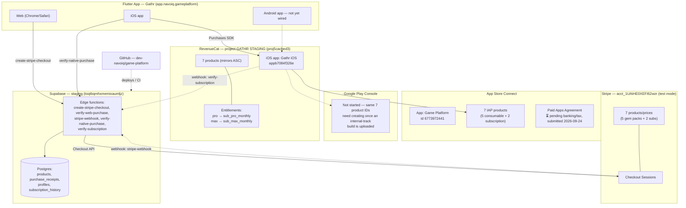

# Payment Integrations Map

Internal reference for every external account/service touched by the payment
system (Stripe web checkout + RevenueCat native purchases). No secret values
live in this file — only account identifiers, IDs, and dashboard links, so
it's safe to keep in git. Actual secrets live in Supabase project secrets or
on-disk key files; see **Where the actual secrets live** below.

Last updated: 2026-09-24.

## Architecture



Solid arrows = live and working today. Dashed arrows = configured but
untested (webhooks, pending Apple agreement) or not yet built (Android).

## Reference table

| Service | Account / login | Key identifiers | Dashboard | Status |
|---|---|---|---|---|
| **GitHub** | `ambartyagi` (git config on this machine) | Repo: `dev-navoiq/game-platform` | https://github.com/dev-navoiq/game-platform | ✅ Active |
| **Apple Developer / App Store Connect** | `tuskigupta@navoiq.com` (from `apps/flutter_app/ios/fastlane/Appfile`) | Team ID `GS59945524` · Bundle ID `app.navoiq.gameplatform` · App ID `6773972441` · API key `8MDL92J6J5` (App Manager role) | https://appstoreconnect.apple.com | ⏳ Paid Apps Agreement pending banking/tax (submitted 2026-09-24, ~24h ETA) |
| **Google Play Console** | — (confirm with team; not yet used this session) | Package id will be `app.navoiq.gameplatform` | https://play.google.com/console | ❌ Not started |
| **RevenueCat** | — (confirm with team — whoever ran `gathr-cli` key creation) | Project `GATHR STAGING` (`proj5cacbed3`) · iOS app `appb7084f326e` · Entitlements `pro` (`entle2a57217b8`), `max` (`entlb73e84fae0`) · Public iOS SDK key `appl_RrtJGXjfMyvcTAopYDcyeUZTRvA` | https://app.revenuecat.com | ✅ Products + entitlements + webhook configured. Real purchases blocked on ASC agreement above. |
| **Stripe** | — (confirm with team) | Account `acct_1UAiHE0XEFI62wzr` (test/sandbox mode only) · 7 products (`gem_starter` … `sub_max_monthly`) | https://dashboard.stripe.com | ✅ Live on staging, test mode only |
| **Supabase — staging** | — (confirm with team) | Project ref `toqtbqmhxmemixaumljz` · URL `https://toqtbqmhxmemixaumljz.supabase.co` | https://supabase.com/dashboard/project/toqtbqmhxmemixaumljz | ✅ Active |
| **Supabase — production** | — (confirm with team) | Project ref `obtgysfcyenbfouvfixs` · URL `https://obtgysfcyenbfouvfixs.supabase.co` | https://supabase.com/dashboard/project/obtgysfcyenbfouvfixs | 🚫 Not wired for payments yet — staging only so far |

## Where the actual secrets live

Nothing above is a credential. The real values are stored here — update
this list if a secret's location changes, but never paste the value itself
into git:

| Secret | Where it lives |
|---|---|
| App Store Connect API key (`.p8`) | `~/.appstoreonnect/AuthKey_8MDL92J6J5.p8` (this machine only — not backed up anywhere else; if lost, generate a new one in ASC → Users and Access → Integrations) |
| App Store Connect Shared Secret | Set directly in RevenueCat (iOS app credentials) via `scripts/asc/setup_revenuecat.py`; not stored in any file |
| RevenueCat v1 secret key (`REVENUECAT_SECRET_KEY`) | Supabase secret, staging project |
| RevenueCat webhook secret (`REVENUECAT_WEBHOOK_SECRET`) | Supabase secret, staging project; same value pasted into RevenueCat → Integrations → Webhooks auth header |
| RevenueCat v2 Developer API key | Not stored anywhere — used interactively for `scripts/asc/setup_revenuecat.py`, re-request from RevenueCat if needed again |
| Stripe secret key (`STRIPE_SECRET_KEY`) | Supabase secret, staging project |
| Stripe webhook secret | Supabase secret, staging project (see `PAYMENT-MIGRATION-GUIDE.md`) |

Check what's currently set (values are never shown, only names):
```bash
supabase secrets list --project-ref toqtbqmhxmemixaumljz
```

## Related docs

- `.claude/PAYMENT-MIGRATION-GUIDE.md` — Stripe web checkout setup
- `.claude/REVENUECAT-SETUP-GUIDE.md` — RevenueCat native purchase setup, step by step
- `.claude/TEST-CASES-PAYMENT-SYSTEM.md` — test cases for both flows
- `scripts/asc/` — automation scripts (idempotent) that created the App Store
  Connect and RevenueCat catalog entries; re-run after adding a new product
  to the `products` table
